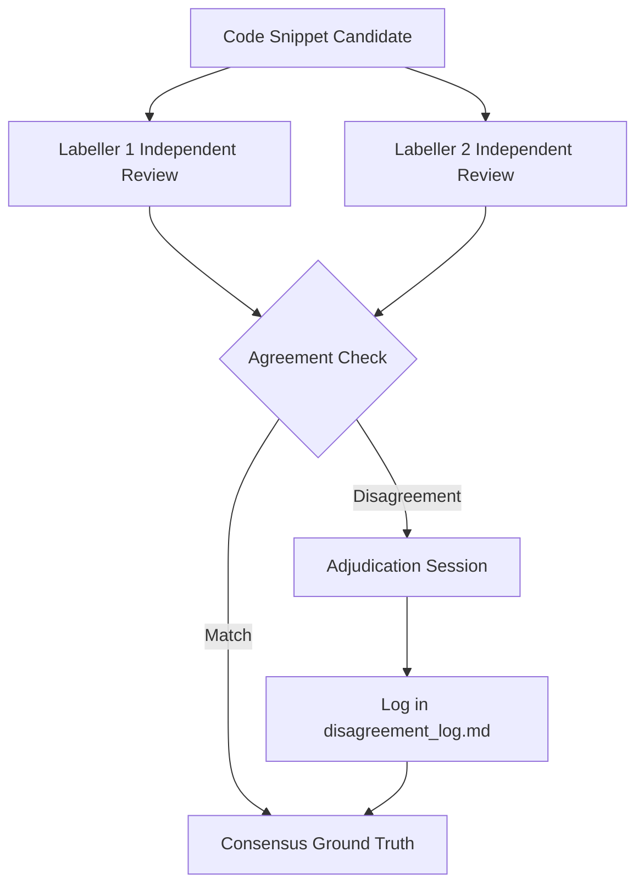

# Static Scanner Ground-Truth Labelling Protocol

## 1. Objective

This protocol governs the construction, curation, and verification of reference ground-truth benchmarks for AgileGraph's static discovery engines across Python, Java, and Go repositories.

The reference set provides objective evaluation of scanner precision, recall, and F1 score against known cryptographic and negative code patterns.

---

## 2. Labelling Dimensions & Schema

Each reference snippet is evaluated by two independent labellers across:

| Field | Description | Allowed Values |
| :--- | :--- | :--- |
| `item_id` | Unique reference snippet identifier | String (e.g. `REF-PY-001`) |
| `language` | Programming language of snippet | `PYTHON`, `JAVA`, `GO` |
| `category` | Graph node category | `crypto_usage`, `certificate`, `endpoint`, `library`, `sensitive_data`, `NEGATIVE` |
| `algorithm` | Exact cryptographic algorithm | e.g. `rsa`, `aes`, `ecdsa`, `sha256`, `none` |
| `operation` | Cryptographic primitive operation | `key_generation`, `encryption`, `signature`, `hashing`, `random`, `tls_config`, `none` |
| `labeller_1_label` | Finding category assigned by Labeller 1 | Category name or `NEGATIVE` |
| `labeller_2_label` | Finding category assigned by Labeller 2 | Category name or `NEGATIVE` |
| `consensus_label` | Adjudicated truth (must match both or resolution log) | Category name or `NEGATIVE` |

---

## 3. Inclusion & Exclusion Rules

### Positive Criteria
1. **Direct API Invocation**: Verifiable instantiation or invocation of a cryptographic library primitive (e.g., `rsa.GenerateKey`, `Cipher.getInstance("AES/CBC...")`).
2. **Key / Cert Material**: Formatted PEM/DER blocks, PKCS#1/#8 headers, or valid base64 certificate structures.
3. **Endpoint Declaration**: Network socket bind (`0.0.0.0`, port specification), framework route (`@app.get(...)`).
4. **Sensitive Data**: Hardcoded private keys, JWT signing secrets, API passwords.

### Negative Criteria (True Negatives)
1. **Incidental Naming**: Variables or comments containing cryptographic substrings without cryptographic operations (e.g., `crypto_currency = "BTC"`, `aes_table = [1, 2, 3]`).
2. **Commented Code**: Invocations inside comments or docstrings that are not active source code.
3. **Non-Cryptographic Hash**: Checksums used purely for non-security indexing (e.g., hash table bucketing).
4. **Mock Fixtures**: Mock objects in test suites that define no real algorithm parameters.

---

## 4. Two-Labeller Adjudication Workflow

1. **Independent Blinding**: Labellers assign labels independently without access to scanner outputs.
2. **Agreement Calculation**: Unanimous matches are accepted directly into `consensus_label`.
3. **Disagreement Logging**: All disagreements are documented in `backend/dataset/reference_set/disagreement_log.md` with explicit rationale before consensus adoption.
4. **Empty Label Prohibition**: The verification tooling (`verify_scanners.py`) MUST refuse to report metrics if any item in the reference set contains empty or unadjudicated consensus labels.
