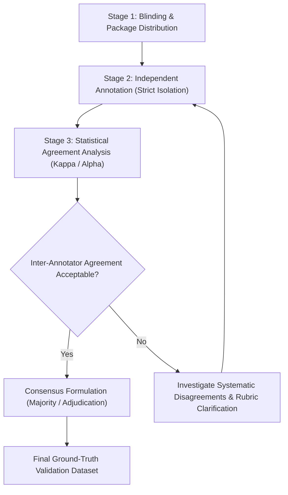

# AgileGraph Expert Annotation Protocol

**Version:** 2.0.0  
**Status:** PROTOCOL FINALIZED (READY FOR HUMAN EXPERT PANEL)  
**Project:** Graph-Learned Crypto-Agility Risk Scoring for Post-Quantum Migration  
**Artifact Path:** `docs/EXPERT_ANNOTATION_PROTOCOL.md`

---

## 1. Scientific Objective and Ground-Truth Independence

AgileGraph models cryptographic asset risk and post-quantum migration urgency through static code analysis and graph neural networks (GATv2). To train and evaluate machine learning models without circular reasoning or confirmation bias:
- **Heuristic scores and graph features MUST NOT be treated as ground truth.**
- **Annotators MUST NOT be exposed to AgileGraph's heuristic scores or model predictions** prior to submitting their independent judgments (strict double-blind protocol).
- Ground truth must reflect authentic, expert human risk assessment rooted in observable cryptographic implementation evidence.

---

## 2. Annotator Cohort and Privacy Protection

### Target Panel Composition
The protocol specifies an evaluation panel of **at least four (4) qualified experts** in applied cryptography, security engineering, and post-quantum readiness:
1. **Applied Cryptographer:** Specialization in algorithmic security, asymmetric cryptosystems, and NIST PQC standards (FIPS 203/204/205).
2. **Security Architect / PQC Lead:** Specialization in enterprise cryptographic agility, legacy system inventory, and migration planning.
3. **Software Security Engineer (Systems/Go/Java):** Experience in cryptographic API misuse, token security, and secure communications.
4. **Software Security Engineer (Python/C-bindings):** Experience in low-level cryptographic libraries, bindings, and certificate validation.

### Privacy and Non-Identifying Pseudonyms
To maintain research confidentiality, avoid anchoring bias, and protect annotator identities:
- Annotators are assigned pseudonymous handles: `expert_01`, `expert_02`, `expert_03`, `expert_04`.
- No Personally Identifiable Information (PII), institutional affiliations, or email addresses are stored in benchmark datasets or version control.
- If four independent qualified experts cannot be secured for a study iteration, **this limitation must be explicitly reported in empirical results rather than simulating expert participation with synthetic generators.**

### Reviewer Ethics, Conflict of Interest, and Institutional Approvals
1. **Conflict of Interest:** Experts must disclose any active maintainer status or commercial affiliation with the scanned open-source repositories (e.g. `pallets/itsdangerous`, `pyca/cryptography`, `jwtk/jjwt`). If a conflict exists for a specific repository, the expert must abstain (`UNKNOWN` or recusal) from evaluating assets in that project.
2. **Confidentiality & Code Snippet Licensing:** All code snippets presented in review dossiers originate strictly from open-source repositories licensed under permissive or standard open-source licenses (MIT, Apache-2.0, BSD-3-Clause). Dossiers are distributed solely for research validation under fair use and applicable project licenses.
3. **Institutional Oversight & Consent:** This protocol defines an engineering peer-evaluation procedure. Institutional Review Board (IRB) review, formal informed consent disclosures, and ethical approvals are subject to the policies of the host institution and must be determined and finalized by the major project guide prior to recruiting human participants. No human ethics approval is claimed in advance.

---

## 3. Sampling Design and Stratification

The evaluation sample comprises **166 assets** deterministically selected from the pinned benchmark corpus (seed: `42`).

### Stratification Matrix

| Repository | Language | Size Tier | Pinned Commit SHA | Available Assets | Sampled Assets | Sampling Ratio |
| :--- | :--- | :--- | :--- | :--- | :--- | :--- |
| `python_itsdangerous` | Python | Small | `672971d66a2ef9f85151e53283113f33d642dabd` | 7 | 7 | 100.0% |
| `python_bcrypt` | Python | Small | `59b41aaa24c025d1cd231c37d2755b94184a3e67` | 2 | 2 | 100.0% |
| `python_cryptography` | Python | Large | `f0ba3000a365d44db153362e847c88339c9231f4` | 1,013 | 50 | 4.9% |
| `java_java_jwt` | Java | Small | `29f252b2d6fea74df6576803d5fce5f6d6799cf3` | 34 | 20 | 58.8% |
| `java_jjwt` | Java | Large | `fb71496164c71442d08adec4571d9616ed5e1b8d` | 212 | 35 | 16.5% |
| `go_jwt` | Go | Small | `73c870b18e68b6e654b2b03f485aa3c9fab32cea` | 30 | 15 | 50.0% |
| `go_jwt_go` | Go | Small | `9742bd7fca1c67ba2eb793750f56ee3094d1b04f` | 26 | 12 | 46.2% |
| `go_crypto` | Go | Large | `b39ff6d641ecc5bb4b241737cb0c6b646f3e12a9` | 108 | 25 | 23.1% |
| **Corpus Total** | **All 3** | **Both** | **All Pinned** | **1,432** | **166** | **11.6%** |

### Language Representation
- **Python:** 59 assets (35.5%)
- **Java:** 55 assets (33.1%)
- **Go:** 52 assets (31.3%)

### Inclusion and Exclusion Rules
- **Included:** Source files containing confirmed cryptographic algorithm usage, key derivation, certificate parsing, signature verification, or token generation.
- **Excluded:** Binary artifacts, autogenerated build manifests, lockfiles, and compiler cache files.

---

## 4. Multi-Stage Annotation Workflow

The annotation process is organized into three strictly sequential phases:

### Stage 1: Blinding and Package Distribution
1. The coordinator generates the dossier package using `backend/scripts/generate_annotation_package.py`.
2. Each dossier provides repository relative path, language, AST code snippets, detected algorithm identifiers, parameter values, certificates, and dependency references.
3. **Heuristic risk scores, rule scores, and model predictions are omitted from annotator packages.**
4. Annotators receive the package `dataset/annotation/sample_annotation_package.json` along with the submission template `dataset/annotation/expert_submission_template.json`.

### Stage 2: Independent Annotation (Strict Isolation)
1. Annotators complete evaluations independently without conferring with other panel members.
2. Annotators evaluate all 7 dimensions of the rubric for each asset.
3. Abstentions (`UNKNOWN`, `INSUFFICIENT_EVIDENCE`) are explicitly permitted when evidence is incomplete.
4. Each submission is time-stamped and signed with the pseudonymous `expert_id`.

### Stage 3: Inter-Annotator Agreement & Adjudication
1. Submissions are imported and validated via `backend/src/ml/import_annotations.py`.
2. Pairwise weighted Cohen's $\kappa$, Fleiss' $\kappa$, and Krippendorff's $\alpha$ are computed via `backend/src/ml/agreement.py`.
3. If annotators disagree on `migration_priority`:
   - An adjudication panel reviews the original judgments and submitted rationales.
   - An `AdjudicatedLabel` is formulated, recording the consensus rating, adjudicator ID, method (`MAJORITY_VOTE` or `ADJUDICATION`), and detailed rationale.
   - **Original individual judgments are permanently preserved alongside the adjudicated record.**

---

## 5. Statistical Agreement Metrics and Acceptance Criteria

### Agreement Measures
1. **Weighted Cohen's Kappa ($\kappa_w$, Quadratic):** Measures pairwise agreement for ordinal priority labels (`LOW` < `MEDIUM` < `HIGH`), penalizing multi-step disagreements more heavily than adjacent differences.
2. **Krippendorff's Alpha ($\alpha$, Ordinal):** Handles multiple annotators simultaneously and naturally accommodates missing ratings or partial coverage.
3. **Fleiss' Kappa ($\kappa_F$):** Evaluates multi-rater nominal agreement across the panel.
4. **Per-Class Confusion Matrices & F1 Scores:** Identifies boundary ambiguities (e.g. `MEDIUM` vs `HIGH`).

### Benchmark Acceptance Thresholds (Study Criteria & Justification)
The conventional thresholds proposed for this study are derived from Krippendorff (2011) and Landis & Koch (1977):
- $\alpha \ge 0.80$: **High Reliability Target** — Proposed as the primary milestone for adopting adjudicated labels as a gold-standard validation benchmark.
- $0.67 \le \alpha < 0.80$: **Tentative Agreement** — Common in complex semantic code annotation; acceptable for exploratory model evaluation with documented adjudication.
- $\alpha < 0.67$: **Insufficient Reliability** — Signals systemic divergence in annotator interpretations or insufficient evidence in code snippets; requires rubric revision or evidence enhancement before model training.

> **Methodological Caution:** The $\alpha \ge 0.80$ threshold is a **pre-specified study target requiring empirical verification**, not a foregone conclusion, proof of label veracity, or proof of model correctness. Statistical concordance indicates shared interpretation of evidence, not absolute ground truth. No agreement metric may be calculated or claimed until genuine expert submissions are completed.

---

## 6. Research-Integrity Commitments

1. **No Synthetic Experts:** Never generate simulated labels, LLM annotations, or random votes and present them as human expert consensus.
2. **Preservation of Disagreement:** Disagreements reflect genuine real-world ambiguity in post-quantum risk; they must be documented rather than smoothed over.
3. **Audit Trail:** Every imported annotation record includes Git commit hash, rubric version, timestamp, and validator status.
