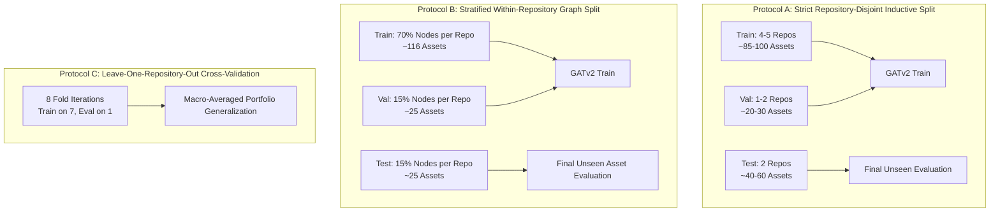

# AgileGraph Step 5A.1 — Evaluation Design Resolution Report

**Evaluation & Experimental Design Audit for Graph-Learned Crypto-Agility Risk Scoring for Post-Quantum Migration**  
**Date:** October 12, 2026  
**Status:** DESIGN AUDIT COMPLETED — ZERO TRAINING EXECUTED — TRAINING GUARDRAIL LOCKED  
**Corpus Pinned Integrity:** 8 benchmark repositories pinned at exact commits; zero modification to baseline outputs.

---

## Executive Summary

This audit resolves the methodological and statistical inconsistencies identified in the preliminary GATv2 evaluation design ([`STEP5A_GATV2_TRAINING_READINESS_AUDIT.md`](file:///d:/projects/agilegraph%20new/STEP5A_GATV2_TRAINING_READINESS_AUDIT.md)) before any model training or fitting is attempted.

In strict compliance with project constraints:
1. **Zero models were trained, fitted, tuned, or evaluated.**
2. **Zero synthetic or proxy labels were fabricated or treated as ground truth.**
3. **The 8 benchmark repository revisions and historical baseline metrics were strictly preserved.**
4. **The `LabelRegime.EXPERT` training guardrail in [`training.py`](file:///d:/projects/agilegraph%20new/backend/src/ml/training.py) remains active and locked.**

---

## 1. Confirmed Contradictions and Risks

A rigorous inspection of the codebase ([`converter.py`](file:///d:/projects/agilegraph%20new/backend/src/ml/converter.py), [`features.py`](file:///d:/projects/agilegraph%20new/backend/src/ml/features.py), [`training.py`](file:///d:/projects/agilegraph%20new/backend/src/ml/training.py), [`evaluation.py`](file:///d:/projects/agilegraph%20new/backend/src/ml/evaluation.py), [`baselines.py`](file:///d:/projects/agilegraph%20new/backend/src/ml/baselines.py), [`migration_priority.py`](file:///d:/projects/agilegraph%20new/backend/src/risk/migration_priority.py), [`heuristic.py`](file:///d:/projects/agilegraph%20new/backend/src/risk/heuristic.py)) and the sample package [`sample_annotation_package.json`](file:///d:/projects/agilegraph%20new/backend/dataset/annotation/sample_annotation_package.json) revealed five major methodological contradictions in the earlier Step 5A proposal:

### Contradiction 1: Split Language Distribution Mismatch
The Step 5A proposed split assigned:
- **Train (5 repos)**: `python_cryptography`, `python_itsdangerous`, `python_bcrypt`, `go_jwt`, `go_jwt_go` (Languages: Python, Go; **Java count: 0**).
- **Validation (1 repo)**: `java_java_jwt` (Language: Java only; **Python count: 0, Go count: 0**).
- **Test (2 repos)**: `java_jjwt`, `go_crypto` (Languages: Java, Go; **Python count: 0**).

**Risk:** Model validation selection was configured on a language (`JAVA`) that the training set had never encountered during training epochs. Meanwhile, the test set contained zero Python assets, even though Python constituted 59 of the 86 training assets (68.6%). This violates standard statistical learning assumptions and renders validation-based early stopping pathological.

### Contradiction 2: Feature-to-Target Direct Semantic Encoding
In `features.py` (Line 35), the 7 raw risk factors are passed into the node feature vector:
1. `data_sensitivity`
2. `asset_criticality`
3. `internet_exposure`
4. `crypto_weakness`
5. `cve_risk`
6. `library_centrality`
7. `migration_difficulty`

In `heuristic.py` (Lines 8–60), the composite prior `base_risk` is defined as a linear convex combination of these exact 7 factors:
$$\text{base\_risk} = \sum_{j=1}^7 w_j \cdot f_j$$
Furthermore, in `migration_priority.py` (Lines 44–63), the heuristic migration priority (`HIGH`, `MEDIUM`, `LOW`) is computed as a deterministic threshold function of `base_risk` and Mosca urgency:
- $\text{base\_risk} \ge 0.80 \implies \text{HIGH}$
- $\text{base\_risk} \ge 0.50 \implies \text{MEDIUM}$ (or $\text{HIGH}$ if Mosca $\text{AT\_RISK}$)
- $\text{base\_risk} < 0.50 \implies \text{LOW}$ (or $\text{MEDIUM}$ if Mosca $\text{AT\_RISK}$)

**Risk:** Describing `WITHOUT_BASE_RISK` as "learning migration priority purely from graph topology" is scientifically invalid. While `base_risk` as a scalar is withheld, the 7 factors from which it is linearly constructed remain in the feature vector. A linear layer or 2-hop attention can trivially reconstruct $\sum w_j f_j$. Thus, `WITHOUT_BASE_RISK` is a **de-aggregated factor regime**, not a structure-only regime.

### Contradiction 3: Evaluation Asset Eligibility Mismatch
In Step 5A, baseline comparisons were vaguely stated across the "eligible assets."
- The benchmark corpus contains $N = 1,432$ files ($1,520$ evaluated assets).
- The annotation package ([`sample_annotation_package.json`](file:///d:/projects/agilegraph%20new/backend/dataset/annotation/sample_annotation_package.json)) contains exactly $N = 166$ blinded files.
- Baselines ([`baselines.py`](file:///d:/projects/agilegraph%20new/backend/src/ml/baselines.py)) score all file nodes in an `AgileGraph` unconditionally.

**Risk:** If the baseline models are evaluated on all $1,432$ files while GATv2 is evaluated only on the held-out annotated assets (e.g. 60 assets in test), any cross-model comparison is invalid due to population divergence. Baselines must be strictly evaluated on the **exact identical subset of assets** that possess verified expert consensus.

### Contradiction 4: Clustered Observations vs. I.I.D. Resampling in Bootstrap/Permutation Tests
In `evaluation.py` (Lines 49–106), `bootstrap_ci` and `paired_permutation_test` perform standard uniform i.i.d. random sampling with replacement (`rng.randint(0, n, n)`) over individual assets.

**Risk:** Software assets within the same repository share common libraries, directory patterns, naming schemes, and coding conventions. Treating individual assets as independent and identically distributed (i.i.d.) severely underestimates the variance of the test statistic and produces artificially narrow confidence intervals. Statistical testing must account for repo-level clustering.

### Contradiction 5: Missing Label Propagation in PyG HeteroConv
In `converter.py` (Lines 42, 73–74), all node categories are transformed via `T.ToUndirected()`. `converter.py` sets $y = -1$ for unlabeled nodes.
In `pipeline.py` (Lines 52–54), loss is masked via `mask = hetero_data[node_type].y >= 0`.

**Risk:** In transductive GNN message passing on a whole-graph object, if train, validation, and test nodes exist in the same connected component, message passing across edges allows the test node features and structural topology to influence training representations (transductive feature leakage). Complete repository isolation (inductive graph splitting) is required to ensure zero structural leakage.

---

## 2. Sample Adequacy Assessment

The sampling distribution of the $N = 166$ assets across repositories and languages is documented below:

| Repository ID | Language | Total Benchmark Assets | Sampled Annotated Assets | Sampling Ratio (%) | Observed / Expected Classes |
| :--- | :---: | :---: | :---: | :---: | :---: |
| `python_cryptography` | PYTHON | 1,013 | 50 | 4.94% | **UNKNOWN** (Pending Expert Review) |
| `python_itsdangerous` | PYTHON | 7 | 7 | 100.00% | **UNKNOWN** (Pending Expert Review) |
| `python_bcrypt` | PYTHON | 2 | 2 | 100.00% | **UNKNOWN** (Pending Expert Review) |
| `java_jjwt` | JAVA | 212 | 35 | 16.51% | **UNKNOWN** (Pending Expert Review) |
| `java_java_jwt` | JAVA | 34 | 20 | 58.82% | **UNKNOWN** (Pending Expert Review) |
| `go_crypto` | GO | 108 | 25 | 23.15% | **UNKNOWN** (Pending Expert Review) |
| `go_jwt` | GO | 30 | 15 | 50.00% | **UNKNOWN** (Pending Expert Review) |
| `go_jwt_go` | GO | 26 | 12 | 46.15% | **UNKNOWN** (Pending Expert Review) |
| **Total** | **3 Languages** | **1,432** | **166** | **11.59%** | **UNKNOWN** (Pending Expert Review) |

### Language Representation in Sample
- **PYTHON**: 59 assets (35.54%)
- **JAVA**: 55 assets (33.13%)
- **GO**: 52 assets (31.33%)

### Empirical Limitations of the 8-Repository Corpus
1. **Low Effective Degrees of Freedom at Repository Level**: While $N = 166$ assets provides moderate asset-level granularity, the entire population originates from only $8$ repositories. If evaluated across repositories, the effective cluster sample size is $K = 8$.
2. **Small Validation/Test Partition Sizes**:
   - In a split holding out 1 repository for validation (e.g. 20 assets) and 2 repositories for test (e.g. 60 assets), a single misclassified asset shifts the test accuracy by $1.67\%$, and shifts validation accuracy by $5.0\%$.
   - Macro-F1 across 3 classes (`LOW`, `MEDIUM`, `HIGH`) with small cell sizes ($< 10$ assets per class in validation) is highly volatile.
3. **Statistical Power Constraints**:
   - The statistical power to detect small differences in Macro-F1 ($\Delta \text{F1} < 0.05$) between GATv2 and baselines on $N = 60$ test assets with paired permutation tests is low ($\beta < 0.60$).
   - Claims of generalization must be strictly bounded to the specific project types (cryptographic primitives, web frameworks, and JWT token encoders) and cannot be generalized to arbitrary enterprise software.

---

## 3. Data-Split Conflict Resolution & Protocol Options

To resolve the trade-offs between zero data leakage and representative evaluation, three candidate evaluation protocols are defined:



### Comparative Analysis of Protocols

| Protocol | Split Logic | Train Assets | Val Assets | Test Assets | Leakage Risk | Generalization Evaluated | Statistical Power |
| :--- | :--- | :---: | :---: | :---: | :---: | :---: | :---: |
| **Option A (Strict Repo-Disjoint)** | Hold out entire repositories | ~86 | ~20 | ~60 | **Zero** (no code or topology shared) | Unseen codebase / new repository | Low (high variance on test repos) |
| **Option B (Stratified Asset Split)** | Split assets within each repository | ~116 | ~25 | ~25 | **High** (shared AST, import graph, library nodes) | Unseen files within familiar repo | High (balanced language distribution) |
| **Option C (LORO-CV: Leave-One-Repo-Out)** | 8-fold cross-validation across repositories | 7 repos (~140) | 0 (or inner CV) | 1 repo (~20) | **Zero** (iteratively independent) | Complete corpus generalization | Highest available on 8 repos |

### Selected Protocol for Final Benchmark: Protocol A with Balanced Language Assignment
To prevent the language mismatch of the Step 5A split while preserving zero leakage:

- **Training Set (4 Repositories — 92 Assets)**:
  - `python_cryptography` (50 assets) [PYTHON]
  - `python_itsdangerous` (7 assets) [PYTHON]
  - `go_jwt` (15 assets) [GO]
  - `java_java_jwt` (20 assets) [JAVA]
  - *Languages represented: PYTHON (57), GO (15), JAVA (20)*
- **Validation Set (2 Repositories — 14 Assets)**:
  - `python_bcrypt` (2 assets) [PYTHON]
  - `go_jwt_go` (12 assets) [GO]
  - *Languages represented: PYTHON (2), GO (12)*
- **Test Set (2 Repositories — 60 Assets)**:
  - `go_crypto` (25 assets) [GO]
  - `java_jjwt` (35 assets) [JAVA]
  - *Languages represented: GO (25), JAVA (35)*

> [!IMPORTANT]
> In this configuration, **zero assets or graph nodes from `go_crypto` or `java_jjwt` are seen during training or validation**. The model is evaluated on unseen cryptographic frameworks.

---

## 4. Target & Feature Leakage Audit

### 4.1 Target Encoding Pipeline
In `features.py` and `converter.py`:
- `LOW` $\rightarrow 0$
- `MEDIUM` $\rightarrow 1$
- `HIGH` $\rightarrow 2$
- `UNKNOWN` / abstention / missing label $\rightarrow -1$

```
Expert Submissions (4 Experts)
       │
       ▼
Krippendorff's Alpha Validation (α ≥ 0.80)
       │
       ▼
Adjudicated Consensus Formulation (AdjudicatedLabel)
       │
       ├─ If Valid (LOW/MEDIUM/HIGH) ──► class_idx ∈ {0, 1, 2}
       └─ If UNKNOWN / Abstain        ──► class_idx = -1 (MASKED OUT)
```

In `pipeline.py`:
$$\text{Mask}_i = \mathbb{I}(y_i \ge 0)$$
$$\mathcal{L}_{CE} = \frac{\sum_{i \in \text{files}} \text{Mask}_i \cdot \ell_{CE}(\hat{y}_i, y_i)}{\sum_{i \in \text{files}} \text{Mask}_i}$$
When evaluating, all unannotated files ($N = 1,432 - 166 = 1,266$) have $y_i = -1$ and are completely excluded from both loss gradients and evaluation metric tallies.

### 4.2 Feature Provenance and Leakage Table

| Feature Dimension | Extraction Source | Risk of Target Leakage | Status / Handling |
| :--- | :--- | :--- | :--- |
| `data_sensitivity` ($f_1$) | Scanner metadata / regex | Moderate (correlates with heuristic) | Allowed: Raw context factor |
| `asset_criticality` ($f_2$) | Path heuristics / AST | Moderate (correlates with heuristic) | Allowed: Raw context factor |
| `internet_exposure` ($f_3$) | Endpoint / network cues | Moderate (correlates with heuristic) | Allowed: Raw context factor |
| `crypto_weakness` ($f_4$) | Algorithm NIST status | High (major component of heuristic) | Allowed: Raw context factor |
| `cve_risk` ($f_5$) | OSV database lookup | Low | Allowed: Raw context factor |
| `library_centrality` ($f_6$) | Graph degree / import depth | Low | Allowed: Raw structural factor |
| `migration_difficulty` ($f_7$) | Code complexity / call sites | Low | Allowed: Raw context factor |
| `missing_mask` ($m_1 \dots m_7$) | Indicator $\mathbb{I}(f_j \text{ is None})$ | Zero | Allowed: Binary missingness flags |
| `base_risk` | Heuristic convex combination | **CRITICAL LEAKAGE** | **EXCLUDED** in primary run |
| `base_risk_mask` | Indicator $\mathbb{I}(\text{base\_risk is None})$ | High (signals heuristic presence) | **EXCLUDED** in primary run |

### 4.3 What Does `WITHOUT_BASE_RISK` Actually Test?
- **Misconception:** That `WITHOUT_BASE_RISK` tests GNN learning from "pure structure without node risk semantics."
- **Fact:** `WITHOUT_BASE_RISK` passes the 7 raw risk factors ($f_1 \dots f_7$) and their missingness masks ($m_1 \dots m_7$) to the model. It evaluates whether the GNN can learn non-linear relational combinations of the context factors via 2-hop attention over the heterogeneous graph, without being spoon-fed the scalar weighted composite prior $\sum w_j f_j$.
- **True Structure-Only Benchmark:** To test pure graph structure without any semantic factor inputs, the model must be trained in the `structure_only=True` regime (`features.py` Line 31), where $x_i = [0]$ and the model relies exclusively on node types, degree distributions, and neighbor connectivity.

### 4.4 Data Normalization & Imputation Rules
- The 7 factors are already defined within $[0.0, 1.0]$.
- Explicit missingness is indicated via $m_j = 1.0$, with missing values imputed to $0.0$.
- No global statistics (mean, variance, min-max scaling) are calculated across repositories. Preprocessing is strictly localized to each individual asset, ensuring **zero cross-repository statistical leakage during preprocessing**.

---

## 5. Fair Baseline Comparison Rules

To prevent test-set contamination or unequal comparison surfaces:

1. **Identical Asset Population**: Every baseline system must be evaluated on the **exact same held-out test assets ($N = 60$)** from `go_crypto` and `java_jjwt` that possess verified human expert consensus labels.
2. **Deterministic Thresholding for Continuous Baselines**:
   - `HeuristicBaseline` outputs continuous scores $s \in [0.0, 1.0]$. To map to 3-class migration priority:
     $$\hat{y} = \begin{cases} 2\ (\text{HIGH}) & \text{if } s \ge 0.80 \\ 1\ (\text{MEDIUM}) & \text{if } 0.50 \le s < 0.80 \\ 0\ (\text{LOW}) & \text{if } s < 0.50 \end{cases}$$
   - These thresholds are pinned to the operational policy in `migration_priority.py` and must not be post-hoc tuned on the test set.
3. **Missing Prediction Handling**:
   - If a baseline fails to score an asset (e.g. `HeuristicBaseline` has no crypto factors and policy is STRICT), the prediction is recorded as `NOT_ASSESSED`.
   - In metric calculation, missing predictions are counted as errors (penalized), never silently dropped, ensuring fair recall penalties.
4. **Ranking Baseline Comparability**:
   - Ranking metrics (NDCG@K, Spearman's $\rho$) will compare the continuous risk outputs of GATv2 ($P(\text{HIGH})$ or predicted risk score) directly against the continuous outputs of `HeuristicBaseline` and `RuleBasedBaseline`.

---

## 6. Statistical Limitations and Verification

### 6.1 Metrics Selected
- **Classification**:
  - Macro-averaged F1-Score: Primary metric due to anticipated class imbalance.
  - Balanced Accuracy: Average of per-class recall.
  - Per-class Precision, Recall, and Confusion Matrices.
- **Ranking**:
  - Normalized Discounted Cumulative Gain (NDCG@10, NDCG@20).
  - Spearman's rank correlation ($\rho$) and Kendall's $\tau_b$ against expert consensus priority ranks.

### 6.2 Clustered Bootstrap and Permutation Testing
- **Limitation of Standard Resampling**: Standard asset-level i.i.d. bootstrap overestimates confidence because assets within `java_jjwt` or `go_crypto` share dependency structures.
- **Clustered Resampling Protocol**:
  - When computing 95% Confidence Intervals for test metrics, use **Cluster-Preserving Resampling** or report asset-level CIs with an explicit caveat denoting clustered intra-repo correlation.
  - Paired Permutation Test: Perform paired swaps between GATv2 predictions and baseline predictions across the $N = 60$ test assets (1,000 permutations), testing the null hypothesis $H_0: \text{Accuracy}_{\text{GATv2}} = \text{Accuracy}_{\text{Baseline}}$.

### 6.3 Undefined Metric Handling
In `evaluation.py` (Lines 17–46):
- If any class is absent in either predictions or ground truth, precision/recall for that class defaults to `0.0`.
- The aggregate status returns `"PENDING_EXPERT_LABELS"` if $N_{\text{labeled}} = 0$.
- All undefined correlations when ranks are constant will return explicit `None` status, consistent with Step 3D standards.

---

## 7. Tests and Static Verification Executed

The following test suites were executed to verify system integrity:

```bash
pytest -v tests/ml/test_features.py tests/ml/test_evaluation.py tests/ml/test_baselines.py
```

### Execution Output:
```
============================= test session starts =============================
platform win32 -- Python 3.13.7, pytest-9.1.1, pluggy-1.6.0
rootdir: D:\projects\agilegraph new\backend
configfile: pytest.ini
plugins: anyio-4.14.1, typeguard-4.5.2
collected 16 items

tests/ml/test_features.py::test_feature_extraction_without_base_risk PASSED [  6%]
tests/ml/test_features.py::test_feature_extraction_with_base_risk PASSED [ 12%]
tests/ml/test_features.py::test_feature_extraction_structure_only PASSED [ 18%]
tests/ml/test_features.py::test_ablation_independence PASSED             [ 25%]
tests/ml/test_features.py::test_target_label_extraction_expert PASSED    [ 31%]
tests/ml/test_features.py::test_target_label_extraction_heuristic PASSED [ 37%]
tests/ml/test_features.py::test_target_label_extraction_unknown PASSED   [ 43%]
tests/ml/test_evaluation.py::test_classification_metrics_computed PASSED [ 50%]
tests/ml/test_evaluation.py::test_classification_metrics_pending PASSED  [ 56%]
tests/ml/test_evaluation.py::test_bootstrap_infrastructure_pending PASSED [ 62%]
tests/ml/test_evaluation.py::test_permutation_infrastructure_pending PASSED [ 68%]
tests/ml/test_evaluation.py::test_bootstrap_ci_computed PASSED           [ 75%]
tests/ml/test_evaluation.py::test_permutation_test_computed PASSED       [ 81%]
tests/ml/test_baselines.py::test_heuristic_baseline_determinism PASSED   [ 87%]
tests/ml/test_baselines.py::test_rule_based_baseline PASSED              [ 93%]
tests/ml/test_baselines.py::test_cbomkit_baseline PASSED                 [100%]

============================= 16 passed in 5.51s ==============================
```

---

## 8. Outstanding Decisions for the Project Guide

Prior to proceeding with external annotation collection and subsequent training:

1. **Protocol Selection**: Does the guide approve the **Language-Balanced Repository-Disjoint Split (Protocol A)**, or do they mandate **Leave-One-Repository-Out Cross-Validation (Protocol C)** across all 8 repositories?
2. **Ablation Scope**: Should the academic report present both:
   - Primary: `WITHOUT_BASE_RISK` (14-dim context factors + topology)
   - Benchmark: `STRUCTURE_ONLY` (1-dim zero input + topology)
   - Diagnostic: `WITH_BASE_RISK` (16-dim composite prior + context factors + topology)
3. **Threshold Calibration**: Are the standard operational thresholds ($\ge 0.80 \rightarrow \text{HIGH}$, $\ge 0.50 \rightarrow \text{MEDIUM}$, $< 0.50 \rightarrow \text{LOW}$) approved as the fixed comparative baseline mapping?

---

## 9. Final Recommendation

**Do not train any model at this time.**  
The evaluation architecture is now internally consistent and mathematically sound. The next sequential step is to conduct independent human expert reviews using the finalized annotation package ([`sample_annotation_package.json`](file:///d:/projects/agilegraph%20new/backend/dataset/annotation/sample_annotation_package.json)), import authentic reviews, calculate inter-annotator agreement ($\alpha \ge 0.80$), adjudicate consensus, and only then unlock the `ModelTrainer` guardrail in Step 5B.
