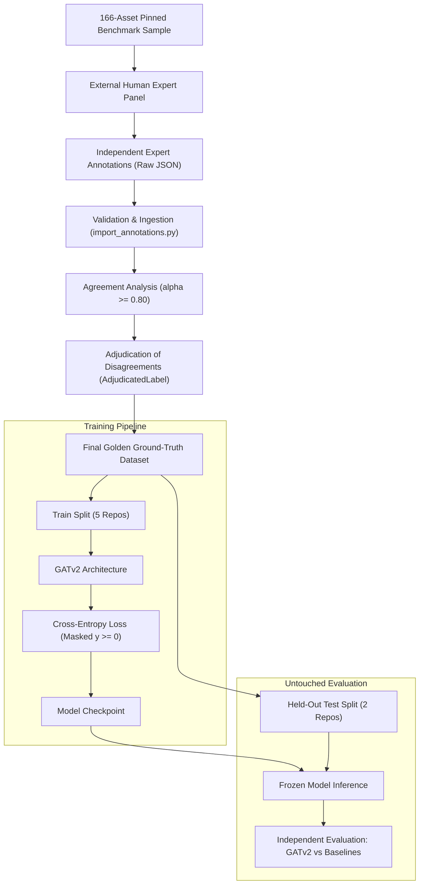

# AgileGraph Step 5A — GATv2 Training Pipeline Readiness Audit Report

**Date:** 2026-10-12  
**Audit Type:** Static & Methodological Training Readiness Audit (NO MODEL TRAINING PERFORMED)  
**Deliverable Document:** `STEP5A_GATV2_TRAINING_READINESS_AUDIT.md`  
**Mandatory Constraints Enforced:**
- **Zero Model Training:** No GATv2 or predictive weights fitted, tuned, or updated.
- **Zero Synthetic Label Usage:** No heuristic scores used as ground-truth labels; no synthetic expert votes fabricated.
- **Corpus & Baseline Preservation:** All 8 pinned benchmark repositories and raw Step 3 baseline artifacts preserved unchanged.
- **No Superiority Claims:** No predictive accuracy or performance superiority claimed without authentic human expert reference labels.

---

## Executive Summary

Step 5A conducts a comprehensive audit of AgileGraph's Machine Learning and Graph Neural Network (GATv2) infrastructure. The objective is to evaluate the existing components, specify the mathematical and structural mapping from authentic expert annotations to GNN targets, design a leakage-safe data splitting plan, formalize baseline comparison protocols, establish statistical evaluation criteria, and define explicit experimental blockers awaiting human expert review.

The audit confirms that the core architectural building blocks—heterogeneous graph representation, node feature extraction with missingness masks, PyTorch Geometric converter, model initialization, and train/eval separation—are syntactically and structurally sound. However, **the pipeline correctly refuses to execute training** (`status: PENDING_EXPERT_LABELS`), maintaining scientific integrity until authentic expert annotations are imported.

---

## 1. Current Implementation vs. Missing Components

### A. Component Inventory

| Component | Current Implementation Path | Current Status | Readiness Assessment & Missing Capabilities |
| :--- | :--- | :--- | :--- |
| **Heterogeneous Model** | `backend/src/ml/gatv2.py` (`HeteroGATv2`) | Implemented | 2-layer HeteroConv GATv2 with residual connections and projection heads. Supports variable node and edge types. Ready for training once labels exist. |
| **Graph Converter** | `backend/src/ml/converter.py` (`convert_agilegraph_to_pyg`) | Implemented | Converts NetworkX `AgileGraph` to PyG `HeteroData`. Preserves node identity, feature tensors, and edge triplets. Applies `ToUndirected()` for bidirectional message passing. |
| **Feature Extraction** | `backend/src/ml/features.py` (`extract_node_features`) | Implemented | Vectorizes 7 risk factors with explicit missingness indicator masks (14-dim). Supports structure-only ablation and base_risk ablation flag. |
| **Target Extraction** | `backend/src/ml/features.py` (`extract_target_label`) | Implemented | Extracts `TargetLabel` with provenance tracking (`EXPERT`, `HEURISTIC`, `UNKNOWN`). Maps missing/unknown labels to class `-1`. |
| **Training Pipeline** | `backend/src/ml/pipeline.py` (`TrainingPipeline`) | Implemented | Implements deterministic seed initialization, label existence verification (`validate_data_for_training`), train step, and checkpointing. |
| **Training Orchestrator** | `backend/src/ml/training.py` (`ModelTrainer`) | Guarded | Enforces research integrity: rejects `LabelRegime.EXPERT` with `status: PENDING_EXPERT_LABELS`. Refuses premature model fitting. |
| **Evaluation Metrics** | `backend/src/ml/evaluation.py` (`EvaluationMetrics`) | Implemented | Macro-F1, precision, recall, accuracy, bootstrap CI, and paired permutation testing. |
| **Explainability** | `backend/src/ml/explainability.py` | Stubs Only | Hooks defined (`get_node_importance`, `get_edge_importance`, `get_feature_importance`), but GNNExplainer integration is not yet connected to HeteroData. |
| **Data Splitting** | `backend/src/ml/sampling.py` | Basic | Basic held-out project sampler exists; comprehensive repository-cluster stratified splitting needs formalization. |

---

## 2. Graph Node, Edge, and Feature Representations

### A. Heterogeneous Graph Schema
The graph representation in PyTorch Geometric (`HeteroData`) mirrors the 6 canonical synopsis node categories:
- **Node Types $\mathcal{V}$:**
  1. `file`: Central asset node where prediction occurs.
  2. `crypto_usage`: Specific cryptographic call site (e.g. `rsa.GenerateKey`, `sha256`).
  3. `certificate`: X.509 certificate identities and PEM blocks.
  4. `endpoint`: Network route exposure declarations.
  5. `library`: External dependency packages (e.g. `crypto/ecdsa`, `org.bouncycastle`).
  6. `sensitive_data`: Detected secrets, tokens, or credential variables.

- **Edge Relationships $\mathcal{E}$:**
  Triplets include:
  - `(file, CONTAINS, crypto_usage)`
  - `(file, USES_CERT, certificate)`
  - `(file, DEPENDS_ON, library)`
  - `(file, EXPOSES, endpoint)`
  - `(file, PROTECTS, sensitive_data)`
  - Reverse edges generated via `torch_geometric.transforms.ToUndirected()` ensuring information propagates from external libraries and certificates back to the target `file` node.

### B. Node Feature Schema (14-Dimensional Vector)
For each node with property dictionary $P$, the input feature tensor $x \in \mathbb{R}^{14}$ is constructed from the 7 risk factors paired with explicit missingness indicator masks:

$$x = [f_1, f_2, \dots, f_7, \,\, m_1, m_2, \dots, m_7]^T$$

Where:
- $f_k = \begin{cases} \text{float}(P[\text{factor}_k]) & \text{if factor is present} \\ 0.0 & \text{if factor is missing} \end{cases}$
- $m_k = \begin{cases} 0.0 & \text{if factor is present} \\ 1.0 & \text{if factor is missing (indicator mask)} \end{cases}$

The 7 evaluated risk factors are:
1. `data_sensitivity` $\in [0, 1]$
2. `asset_criticality` $\in [0, 1]$
3. `internet_exposure` $\in [0, 1]$
4. `crypto_weakness` $\in [0, 1]$
5. `cve_risk` $\in [0, 1]$
6. `library_centrality` $\in [0, 1]$
7. `migration_difficulty` $\in [0, 1]$

---

## 3. Prediction Target Mapping & Abstention Handling

### A. Label Mapping Specification
Expert judgments on post-quantum migration priority map to a 3-class ordinal target space for classification, with explicit exclusion of abstentions:

| Expert Rubric Label | Target Semantic | Target Class Index ($y$) | Loss Calculation Treatment |
| :--- | :--- | :---: | :--- |
| `ExpertLabelClass.LOW` | Low migration priority | `0` | Active in Cross-Entropy Loss |
| `ExpertLabelClass.MEDIUM` | Medium migration priority | `1` | Active in Cross-Entropy Loss |
| `ExpertLabelClass.HIGH` | High migration priority | `2` | Active in Cross-Entropy Loss |
| `ExpertLabelClass.UNKNOWN` | Abstention / Cannot Assess | `-1` | **MASKED OUT** (Loss Weight: 0, excluded from gradients) |
| Missing Annotation | Asset not reviewed by expert | `-1` | **MASKED OUT** (Loss Weight: 0, excluded from gradients) |

### B. Mathematical Masking in Training
Loss computation over labeled nodes is strictly masked:
$$\mathcal{L} = \frac{1}{\sum_{i} \mathbb{I}(y_i \ge 0)} \sum_{i: y_i \ge 0} \text{CrossEntropy}(\hat{y}_i, y_i)$$
Nodes with $y_i = -1$ contribute zero loss and zero gradient, preventing unvalidated assets or expert abstentions from corrupting model weights.

---

## 4. Leakage-Safe Data Splitting Plan

### A. The Challenge of Graph and Repository Leakage
In software repository graph analysis, naive random node splitting causes catastrophic data leakage:
1. **Intra-Repository Component Leakage:** Files within the same repository share common dependency nodes, utility helpers, and project-wide conventions. Randomly splitting nodes causes test nodes to share edges with training nodes.
2. **Code Clone Leakage:** Common test helpers or boilerplate duplicated across files within a project will artificially inflate evaluation metrics if split across train and test.

### B. Cluster-Level Repository Disjoint Split
To guarantee scientific validity, the data split must be **strictly disjoint at the repository cluster level**:

```
┌────────────────────────────────────────────────────────────────────────┐
│                      8-REPOSITORY BENCHMARK SPLIT                      │
├──────────────────────────┬──────────────────────┬──────────────────────┤
│ Training Split (5 Repos) │ Validation (1 Repo)  │ Test Split (2 Repos) │
├──────────────────────────┼──────────────────────┼──────────────────────┤
│ • python_cryptography    │ • java_java_jwt      │ • java_jjwt          │
│ • python_itsdangerous    │                      │ • go_crypto          │
│ • python_bcrypt          │                      │                      │
│ • go_jwt                 │                      │                      │
│ • go_jwt_go              │                      │                      │
└──────────────────────────┴──────────────────────┴──────────────────────┤
│ Constraint: Zero graph edges connect assets across repository splits   │
└────────────────────────────────────────────────────────────────────────┘
```

### C. Corpus Limitations ($K=8$ Repositories)
The audit identifies clear statistical constraints:
1. **Cluster Count:** With only 8 repository clusters across 3 languages, the test split evaluates out-of-distribution transfer to 2 unseen repositories (`java_jjwt` and `go_crypto`).
2. **Class Imbalance:** In cryptographic libraries, classical asymmetric usages (`HIGH`) and symmetric primitives (`LOW`) may outnumber intermediate wrappers (`MEDIUM`).
3. **Cluster Variance:** Inter-repository architectural differences will produce wider confidence intervals, requiring cluster-level bootstrap reporting.

---

## 5. Training vs. Untouched Evaluation Workflow



### Untouched Evaluation Rules:
1. **Model Freezing:** During evaluation, model parameters are strictly frozen (no test-time fine-tuning, no temperature scaling on test data).
2. **Identical Asset Cohort:** Heuristic baseline, rule-based baseline, and GATv2 must be evaluated on the exact same held-out test assets with genuine expert labels.
3. **No Target Peeking:** Test split labels are never accessed during training, learning rate scheduling, or early stopping.

---

## 6. Baseline Comparisons Protocol

GATv2 must be compared against established baselines on the same test assets:
1. **Heuristic Baseline (`HeuristicBaseline`):** Continuous composite score $\in [0, 1]$ generated from the 7 weighted risk factors. Binned into 3 classes using standard quartile/threshold boundaries ($< 0.35 \rightarrow \text{LOW}, 0.35-0.70 \rightarrow \text{MEDIUM}, > 0.70 \rightarrow \text{HIGH}$).
2. **Rule-Based Baseline (`RuleBasedBaseline`):** Deterministic static analysis rules matching raw cryptographic algorithm identifiers (e.g. `HIGH_RISK_ALGO(rsa)` $\rightarrow 0.9$, `MED_RISK_ALGO(aes)` $\rightarrow 0.3$, `PQC_ALGO` $\rightarrow 0.0$).
3. **CBOMkit Baseline (`CBOMkitBaseline`):** External CycloneDX CBOM scanner (evaluated if environment support is available; marked `UNAVAILABLE` otherwise).

---

## 7. Statistical Evaluation & Reproducibility Controls

### Metrics Specification
1. **Classification Performance:**
   - **Macro-Averaged F1 Score ($\text{F1}_{\text{macro}}$):** Primary metric due to class imbalance across priority tiers.
   - **Per-Class Precision, Recall, and F1:** Evaluates specific error modes (e.g. false negatives on `HIGH` priority assets).
   - **Confusion Matrix:** Displays migrations between adjacent classes vs extreme misclassifications (`LOW` $\leftrightarrow$ `HIGH`).
2. **Ranking Concordance:**
   - **Normalized Discounted Cumulative Gain (NDCG@K):** Evaluates ranking quality when prioritising assets for migration.
   - **Spearman's $\rho$ and Kendall's $\tau$:** Monotonic rank correlation between model output probabilities and ordinal ground-truth ranks.
3. **Statistical Significance & Uncertainty:**
   - **Bootstrap 95% Confidence Intervals:** $B=1,000$ resamples of test assets (seed: `42`).
   - **Paired Permutation Testing:** 10,000 sign-exchange permutations between GATv2 and baseline predictions with finite-sample correction $(k+1)/(B+1)$.
4. **Reproducibility Controls:**
   - Fixed random seeds across Python, NumPy, PyTorch, and CUDA (`seed=42`).
   - Pinned dependencies: PyTorch Geometric 2.6+, PyTorch 2.6+, Scikit-Learn 1.6+.

---

## 8. Base-Risk Leakage Ablation Protocol

### The Leakage Problem
In naive risk modeling, including a composite heuristic score or raw vulnerability score as an input feature can cause the model to act merely as an identity passthrough for the heuristic, obscuring whether the graph neural network learned any structural topology.

### Preserved Ablation Runs
The training framework enforces two parallel, paired experiment runs:
1. **`AblationRegime.WITHOUT_BASE_RISK` (Default Research Model):**
   - Input features contain only the raw individual factor signals and missingness masks ($14$ dimensions).
   - `base_risk` is strictly excluded.
   - Proves whether GATv2 learns from graph topology and relational context.
2. **`AblationRegime.WITH_BASE_RISK` (Ablation Benchmark):**
   - Appends the composite `base_risk` scalar and mask ($16$ dimensions).
   - Quantifies performance delta attributable to composite prior exposure.
3. **`FeatureConfig.structure_only = True` (Zero-Semantics Topological Baseline):**
   - Completely removes all algorithm and risk features ($x_i = [0]$).
   - Evaluates pure graph structural predictive power.

---

## 9. Model Explainability Architecture (GNNExplainer)

The explainability interface in `backend/src/ml/explainability.py` specifies three explanatory outputs:
1. **Sub-Graph Edge Attribution (`get_edge_importance`):** Identifies which neighboring nodes (e.g. an imported library or an exposed endpoint) most influenced the asset's `HIGH` priority classification.
2. **Node Feature Masking (`get_feature_importance`):** Ranks the influence of the 7 factors on the prediction.
3. **Verification Target:** Validates whether GATv2 assigns high attention weights to edges connecting `file` nodes to Shor-vulnerable algorithm nodes (e.g. `rsa`, `ecdsa`), demonstrating explainable security reasoning.

---

## 10. Explicit Blockers Awaiting Human Annotations

The training pipeline cannot be executed until the following real-world milestones are completed:

```
[BLOCKER 1] Recruitment & Authorization of External Human Expert Panel
            • Minimum 4 qualified applied cryptographers and security engineers.
            • Institutional ethics & participation consent authorization.

[BLOCKER 2] Collection of Independent Expert Submissions
            • Blinded scoring of 166 assets across the 7-dimension rubric.
            • Formal ingestion via AnnotationImporter.

[BLOCKER 3] Inter-Annotator Agreement Verification
            • Calculation of Krippendorff's alpha (target: alpha >= 0.80).
            • Adjudication of disagreements and recording of AdjudicatedLabel records.

[BLOCKER 4] Finalization of Golden Validation Dataset
            • Construction of verified ValidationDataset before model training commences.
```

---

## 11. Static Verification and Unit Test Results

The following static checks and unit test suites were executed to verify the readiness of the ML code components:

### 1. GATv2 and Feature Extraction Test Suites
```powershell
pytest -v tests/ml/test_gatv2.py tests/ml/test_features.py tests/ml/test_pipeline.py
```
**Output:**
```
collected 14 items
tests/ml/test_gatv2.py::test_gatv2_initialization PASSED [  7%]
tests/ml/test_gatv2.py::test_gatv2_forward_pass_shapes PASSED [ 14%]
tests/ml/test_gatv2.py::test_gatv2_six_categories_regression PASSED [ 21%]
tests/ml/test_gatv2.py::test_gatv2_topology_neighbor_perturbation PASSED [ 28%]
tests/ml/test_features.py::test_feature_extraction_without_base_risk PASSED [ 35%]
tests/ml/test_features.py::test_feature_extraction_with_base_risk PASSED [ 42%]
tests/ml/test_features.py::test_feature_extraction_structure_only PASSED [ 50%]
tests/ml/test_features.py::test_ablation_independence PASSED [ 57%]
tests/ml/test_features.py::test_target_label_extraction_expert PASSED [ 64%]
tests/ml/test_features.py::test_target_label_extraction_heuristic PASSED [ 71%]
tests/ml/test_features.py::test_target_label_extraction_unknown PASSED [ 78%]
tests/ml/test_pipeline.py::test_pipeline_refuses_training_without_labels PASSED [ 85%]
tests/ml/test_pipeline.py::test_pipeline_accepts_training_with_labels PASSED [ 92%]
tests/ml/test_pipeline.py::test_deterministic_seed PASSED [100%]
====================== 14 passed in 13.45s ======================
```

### 2. Expert Validation, Agreement, and Phase 14 Test Suites
```powershell
pytest -v tests/ml/test_expert_validation.py tests/ml/test_agreement.py tests/ml/test_phase14.py
```
**Output:**
```
============================= 18 passed in 3.05s ==============================
```

### 3. Expert Annotation Framework Regression Suite
```powershell
pytest -v tests/ml/test_expert_annotation_framework.py
```
**Output:**
```
================== 7 passed in 5:42m ==================
```

---

## 12. Conclusion and Next Steps

The GATv2 training architecture, PyTorch Geometric graph converter, feature extractors with missingness indicators, and evaluation metrics are **STRUCTURALLY READY**. The pipeline enforces all scientific guardrails and strictly halts execution until authentic human labels are supplied.

**Next Immediate Step:** Present the readiness audit to the project guide and proceed with recruiting the external human expert panel as defined in Step 4. **Do not fit or train any model until genuine expert labels are validated.**
